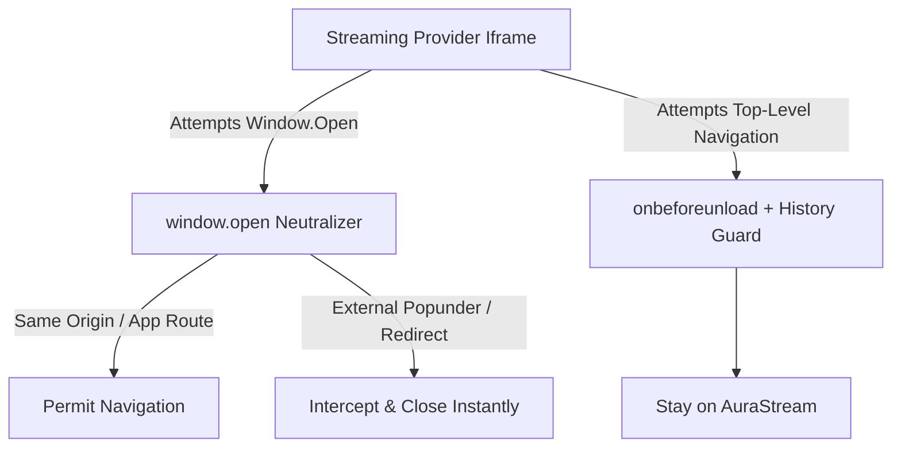

# 🎨 DESIGN AUDIT & EDITORIAL ARCHITECTURE
**Platform:** AuraStream (Lumina)  
**Audit Date:** September 30, 2026  
**Status:** Implemented & Verified

---

## 1. Visual Hierarchy & Module Typology

AuraStream eliminates monotonous, identical 2:3 card rows by deploying an asymmetric editorial layout modeled on Apple TV+ and Criterion Channel:

### 1.1 Cinematic Spotlight Hero Feature
- **Component:** `HeroFeature.tsx`
- **Visuals:** Full-bleed 21:9 / 16:9 high-res backdrop banner, progressive dark scrim (`from-[#060709] via-transparent`), dynamic glassmorphism metadata pill, trailer modal, and direct playback CTA.

### 1.2 Top 10 Worldwide Today (Ranked Editorial Rail)
- **Component:** `RankCard.tsx`
- **Visuals:** Massive italicized editorial numeral typography (`text-7xl` to `text-9xl`) with gradient fill (`from-white via-slate-400 to-slate-800`), overlapping 2:3 poster card with depth drop-shadows (`shadow-2xl shadow-black/90`).
- **Data Flow:** Interleaves verified trending theatrical features and global series hits.

### 1.3 Spotlight Cinema (16:9 Widescreen Rail)
- **Component:** `FeatureCard.tsx`
- **Visuals:** High-density 16:9 widescreen backdrop cards with subtle micro-interactions, category chips (`Masterpiece`, `Featured`), IMDb star ratings, release years, and animated play hover overlays.
- **Navigation:** Direct client-side routing to `/[locale]/[type]/[id]`.

### 1.4 Category Rails (2:3 Vertical Posters)
- **Component:** `PosterCard.tsx`
- **Visuals:** 2:3 portrait cards with dark ambient rim-lighting, liquid-glass rating badges, content-type badges (`ANIME`, `SERIES`, `MOVIE`, `HINDI`, `K-DRAMA`), and quick-action overlay.

---

## 2. Canvas & Color System

| Token | Value | Semantic Usage |
|---|---|---|
| `--color-canvas` | `#060709` | Deep obsidian backdrop; zero gray washout |
| `--color-surface` | `#0d1017` | Card backgrounds and modal containers |
| `--color-border-subtle`| `rgba(255, 255, 255, 0.08)` | Apple-grade fine separation lines |
| `--color-accent` | `#3b82f6` (Sapphire Blue) | Action buttons, active badges, highlights |
| `--color-rating` | `#fbbf24` (Amber Gold) | Star ratings and critical acclaim scores |

---

## 3. Responsive Layout & Mobile Usability

Verified via Playwright viewport tests across:
- **Desktop (1440x900 & 1280x800):** Full multi-column grids, horizontal smooth-momentum carousel scrolling with hardware-accelerated pointer dragging.
- **Tablet (768x1024):** Adaptive 3-4 card rows with touch sliding.
- **Mobile (390x844 & 375x667):** Single/double column feeds, horizontally scrollable server decks with zero overflow or clipping (`overflow-x-clip`), wrap-safe audio badges (`min-w-0 flex-wrap`).

---

## 4. Sandbox-Free Ad Shield Architecture

Unlike generic streaming sites that apply `sandbox` attributes to iframes (breaking fullscreen, Picture-in-Picture, MSE, and audio sync), AuraStream employs a **Sandbox-Free Ad Defense Engine**:

- **Popup Interception:** Monkey-patches `window.open` at window initialization with strict domain allowlisting.
- **Top-Level Navigation Trapping:** Prevents malicious redirect scripts from taking over the user's browsing tab.
- **Zero Video Breaking:** Allows standard HTML5 video events, HLS stream buffers, fullscreen APIs, and browser media controls.
