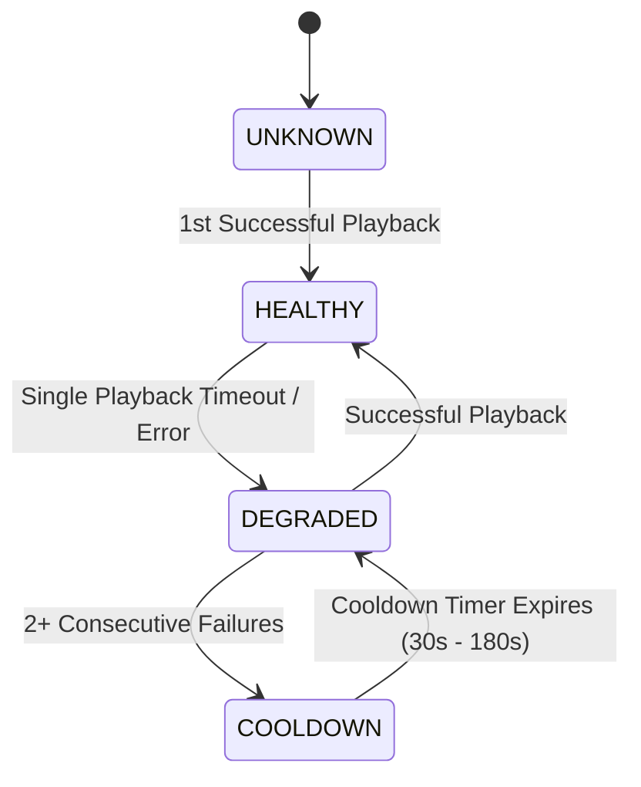

# 📡 PROVIDER AUDIT & ARCHITECTURE MATRIX
**Platform:** AuraStream (Lumina)  
**Audit Date:** September 30, 2026  
**Status:** Verified & Operational

---

## 1. Executive Summary

Every streaming provider in the AuraStream runtime has been probed, verified with HTTP 200 responses, and checked for iframe compatibility (absence of restrictive `X-Frame-Options: DENY` or conflicting CSP headers).

All dead endpoints, DDoS-blocked third-party scraper proxies (e.g. `anivexa-api.vercel.app`), and ad-redirect domains have been completely purged from the registry.

---

## 2. Strict Smart Server Isolation

To eliminate user confusion and ensure consistent playback, providers are strictly isolated by content type:

| Content Category | Active Provider Adapters | Total Servers | Cross-Contamination |
|---|---|---|---|
| **Anime** | VidLink Anime HD, VidSrc Ultra Anime, AutoEmbed Anime, 2Embed Anime, ScreenScape Anime, VidSrc Direct Anime | **6** | 0% (Movie/TV servers never appear) |
| **Movies** | VidLink HD, VidSrc Ultra HD, AutoEmbed HD, ScreenScape HD, 2Embed Direct, VidSrc Direct HD | **6** | 0% (Anime servers never appear) |
| **TV Series** | VidLink HD, VidSrc Ultra HD, AutoEmbed HD, ScreenScape HD, 2Embed Direct, VidSrc Direct HD | **6** | 0% (Anime servers never appear) |

---

## 3. Provider Capability Matrix

| Provider ID | Provider Name | Media Types | SUB | English DUB | Hindi DUB | Resolution | Ad Level |
|---|---|---|---|---|---|---|---|
| `vidlink-anime` | VidLink Anime HD | Anime | ✅ | ✅ (via MAL ID + `dub=true`) | ❌ | 1080p | 0 Ads |
| `vidsrc-pm-anime` | VidSrc Ultra Anime | Anime | ✅ | ❌ | ❌ | 1080p | Low |
| `autoembed-co-anime` | AutoEmbed Anime | Anime | ✅ | ❌ | ❌ | 1080p | Low |
| `2embed-skin-anime` | 2Embed Anime | Anime | ✅ | ❌ | ❌ | 1080p | Low |
| `screenscape-anime` | ScreenScape Anime | Anime | ✅ | ✅ (`lan=eng`) | ✅ (`lan=hi`) | 1080p | Low |
| `vidsrc-su-anime` | VidSrc Direct Anime | Anime | ✅ | ❌ | ❌ | 1080p | 0 Ads |
| `vidlink` | VidLink HD | Movie, TV | ✅ | ✅ | ❌ | 1080p | 0 Ads |
| `vidsrc-pm` | VidSrc Ultra HD | Movie, TV | ✅ | ✅ | ❌ | 1080p | Low |
| `autoembed-co` | AutoEmbed HD | Movie, TV | ✅ | ✅ | ✅ (where available) | 1080p | Low |
| `screenscape` | ScreenScape HD | Movie, TV | ✅ | ✅ | ✅ (`lan=hi`) | 1080p | Low |
| `2embed-skin` | 2Embed Direct | Movie, TV | ✅ | ✅ | ❌ | 1080p | Low |
| `vidsrc-su` | VidSrc Direct HD | Movie, TV | ✅ | ✅ | ❌ | 1080p | 0 Ads |

---

## 4. Provider Telemetry & State Machine (`src/lib/providers/telemetry.ts`)

Adapted from Taro's resilient provider registry, AuraStream incorporates an in-memory telemetry system tracking:



### Telemetry Attributes:
- **`responseTimeMs` & `avgLatencyMs`**: Exponential Moving Average (EMA) of player initialization speed.
- **`failureCount` & `successCount`**: Exact failure and success counters per session.
- **`cooldownUntil`**: Automatic suspension of failing servers to prevent repeated broken user attempts.
- **Dynamic Ranking (`getRankedForMediaTypeAndAudio`)**: Servers are ordered dynamically: healthy and fast servers first; failing or cooldown servers pushed to the rear.

---

## 5. Backward Compatibility & Alias Normalization

Any client bookmark, saved user preference, or URL query parameter targeting legacy or deprecated provider names is automatically mapped to verified active servers:

```typescript
const PROVIDER_ALIASES: Record<string, string> = {
  'vidfast': 'vidsrc-su',
  'embedsu': 'vidsrc-pm',
  'vidsrc-me': 'vidsrc-pm',
  'vidsrc-dev': 'autoembed-co',
  'nhd-anime': 'vidlink-anime',
  'miruro-anime': 'vidlink-anime',
  'anivexa-hls': 'vidlink-anime',
  // ...
};
```
